Keymaps for my keyboards

Sofle:
miryoku_g

XD75Re:
miryoku_g
previous

## Sofle layers

Interactive version: https://gpunto.github.io/Keyboard/ (click layer keys to open layers, hover for keycodes).



Hold-tap keys show their hold action at the bottom; underlined names are layers. ▽ falls through to the layer underneath.

- Game mode: double-tap the Game key on any Miryoku layer (e.g. hold Tab, double-tap W). It stays on until you hold GFn and double-tap Base.
- Right OLED: Conway's Game of Life, seeded by key presses.

## Building and flashing (Sofle)

The Sofle has RP2040 controllers, so `rules.mk` builds with `CONVERT_TO = sparkfun_pm2040`. Link the keymap into a QMK checkout once:

```
ln -s "$PWD/Sofle/miryoku_g" ~/Sviluppo/qmk_firmware/keyboards/sofle/keymaps/miryoku_g
```

Then, with USB in one half:

```
qmk flash -kb sofle/rev1 -km miryoku_g
```

and double-tap that half's reset button. Repeat for the other half, then plug USB back into the left half (the half with USB acts as the left one).

## Redrawing the layer diagram

After changing a keymap, regenerate its diagram and the interactive page's data (needs `uv tool install keymap-drawer`):

```
tools/draw-layers.sh Sofle/miryoku_g sofle/rev1
```
